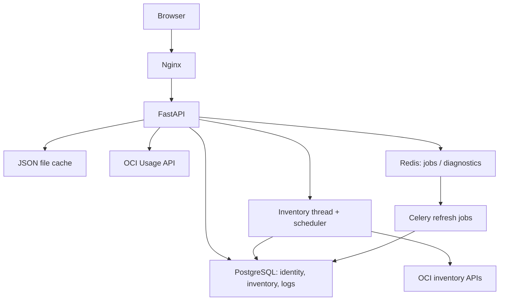

# Runtime architecture, findings and recommendations — Interface 2.2.0

## How this deployment actually works

The user supplied production observations: 108 compartments, zero resources, zero cost snapshots; a running scan interrupted during a backend restart; slow SDK calls delaying unrelated requests; multi-megabyte responses; and large idle worker memory. These measurements and live row counts were not independently verified in the development environment.

The interactive cost pages discussed here primarily use OCI Usage API calls with JSON file caching under `/app/cache`, plus a calculator memory cache. PostgreSQL stores accounts, inventory, scan runs, logs and optional worker-generated aggregates/snapshots. The separate `/cost/*` fast API already reads those aggregates, but the current interactive pages use `/costs/*`, `/dashboard/*` and `/billing/spend` live/cached paths. Redis is not the cost-read cache on those paths. One correction to the supplied description: Redis *is* used by diagnostics caching and worker/job infrastructure.

Nginx fronts a FastAPI backend. Scheduled/manual inventory scans run in a backend-owned thread, not as durable Celery inventory tasks. Celery handles aggregate, snapshot, diagnostics and log-export work. Adding worker processes does not accelerate the in-process scanner or fix blocking API handlers.



## Immediate fixes implemented

| Finding | Change |
|---|---|
| Async routes call blocking SDK/ORM code | Entirely synchronous handlers now use FastAPI's native worker-thread execution. Routes containing awaits remain asynchronous. Billing's complete cache/SDK/ORM/formatting path now also runs in a worker thread. |
| Executor context exit can block after timeout | Reuse bounded OCI read executors; request timeout no longer enters an executor context-manager join on the event loop. Already running SDK work is not forcibly cancelled. |
| by-resource writes but does not read cache | Fresh cached responses return before constructing an OCI calculator. Explicit `refresh=true` bypasses the cache. |
| Repeated Resources cost requests | One scoped cost effect feeds cards, fallback classification, type counts and filtered totals. Compact resource summaries omit full SKU objects. A grouped inventory-count endpoint replaces one request per resource type. |
| Overview limit=1 still returns all resource aggregates | `view=overview` returns at most eight resource summaries per currency, full-period totals and counts. `view=items` omits resource/service aggregate lists from the paged explorer. |
| Raw multi-megabyte transfer | Gzip for direct API responses and both nginx HTTP/generated HTTPS configurations. Proxy connect/read/send budgets are explicit: 10/180/180 seconds. This is a proxy inactivity budget, not cancellation of long-running SDK work. |
| Restart leaves zombie scans | Startup and scan admission recover ownerless running rows using a kernel execution lock, rather than a fixed 30-minute age rule. An owned active scan is not failed simply because it is old. |
| Concurrent Scan Now clicks | Reserve the running row and execution lease before launching the background thread; duplicate admission returns the existing run ID. |
| Entire scan commits at the end | Commit after every inventory compartment, retain those checkpoints on later failure, and report phase/compartment/resource counts in Scan History and backend logs. |
| Silent partial failures | Log failed operations and report the final scan as `partial` when operations failed. Missing image/IP metadata does not discard the whole compute inventory. Images are cached per scan/region. |
| Incomplete attachment lookups can look like unused disks | Mark uncertain attachment state `UNKNOWN`, not `UNATTACHED`, so cleanup does not rely on failed attachment discovery. |
| Request log insert stalls every success | Routine requests go to process logs. Errors and requests exceeding `REQUEST_DB_LOG_SLOW_MS` (default 1000 ms) remain persisted, off the event loop. Explicit audit/event writes remain in place. |
| Schema inspection on every /me | Remove request-time schema ensure; schema setup remains at startup. |
| Unchecked diagnostics show an OCI fault | No check means `unknown`; missing/stale snapshots are separate freshness metadata and do not override a known connected result. |
| Unbounded calculator memory cache | TTL cleanup and thread-safe LRU eviction, default 128 entries, configurable with `COST_MEMORY_CACHE_MAX_ENTRIES`. This is an entry-count bound, not a total process RSS cap. |
| Idle Celery concurrency | Default Compose worker concurrency is two, configurable with host-side `CELERY_WORKER_CONCURRENCY`. |
| Invented license costs on Resources | Removed fixed image/OCPU license-price estimates and missing-cost estimates; no license amount is added on top of OCI-reported charges. Missing period cost remains unavailable. Use Spend explorer for currency and billed-SKU detail. |

## Log retention

`LOG_RETENTION_DAYS` enables daily pruning of operational `log_events`. It defaults to `0` (disabled) until an explicit retention policy is configured. Audit rows and `AuditEvent` history are not pruned by this job. This prevents an application update from silently imposing a retention period on financial/security evidence. A policy such as 30 or 90 days should follow the organization's required retention/export arrangements.

## Deploy and recover the reported scan

Use the existing server checkout on main or master:

```sh
git pull --ff-only
bash deploy/update-app.sh
```

The rebuild now deploys Interface **2.2.0**. Verify `/release.json` and the footer. On backend startup, a running row without an execution owner is marked failed immediately. Then click Scan Now once. Scan History shows its run ID, phase and compartment checkpoints; Refresh History reads the latest progress. No production row was manually changed and no production scan was started from the development session.

The scan remains serial across service/compartment operations. Attachment discovery runs before inventory persistence; the UI now exposes that preflight phase. Checkpoints protect completed inventory compartments, not the currently active compartment. Multi-region/large tenancies can still take minutes; this change does not claim a specific production scan time.

The execution lock supports the current single backend container (including threads/processes sharing its lock path). Do not scale scanner containers across hosts with a local file lock. That requires the durable ownership design below.

## Recommended next architecture, in order

1. **Durable inventory jobs.** Move scans to a dedicated Celery queue with PostgreSQL job ownership/leases, heartbeat, retries, idempotent compartment checkpoints and cancellation. Keep the API as admission/status only. Use bounded compartment concurrency after testing IAM throttling and attachment correctness.
2. **Incremental billing ingestion.** Reuse the existing aggregate refresh components and `/cost/*` fast API, with a reliable ingestion pipeline for resource/SKU/time/currency/subscription charges into PostgreSQL. Preserve credits, billing corrections, units and source timestamps. Query indexed aggregates for dashboards, with an explicit live-refresh operation and a reconciliation view against OCI Cost Analysis/cost reports.
3. **One cache policy and request coalescing.** Consolidate overlapping caches; distinguish fresh/stale/error states, prevent concurrent cold misses for identical queries, and enforce disk/memory budgets. Never turn a failed billing query into a zero invoice.
4. **Operational SLOs and backpressure.** Monitor API p95, event-loop lag, OCI latency/429s, queue age, scan heartbeat and checkpoint counts, response bytes and RSS. Separate API responsiveness from OCI completion time. Use bounded execution budgets rather than adding processes to mask blocking.
5. **Retention and billing correctness.** Configure log retention deliberately, archive audit evidence externally, preserve currencies throughout legacy cost endpoints, and reconcile Marketplace/PAYG/License Included/BYOL charges from evidence rather than server-image assumptions.

## Verification

Regression coverage includes concurrent health probes during a simulated slow OCI call, real cache reuse, compact response size with full totals, scan duplicate admission and restart recovery, compartment checkpoint persistence, incomplete-attachment safety, image lookup reuse, gzip, log-write selection, LRU expiry/eviction, diagnostics freshness and opt-in retention. Production timings, actual RSS reduction, and real tenancy invoice reconciliation still require measurement after deployment.

References: [FastAPI sync path operations](https://fastapi.tiangolo.com/async/#path-operation-functions), [nginx gzip](https://nginx.org/en/docs/http/ngx_http_gzip_module.html), [nginx proxy timeout semantics](https://nginx.org/en/docs/http/ngx_http_proxy_module.html#proxy_read_timeout).
